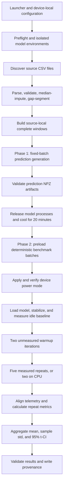

# ForecastPowerBench

ForecastPowerBench is a reproducible benchmark for zero-shot time-series foundation model
(TSFM) inference on heterogeneous hardware. It separates forecast generation from
systems measurement so prediction persistence and accuracy evaluation cannot
contaminate latency, throughput, power, energy, thermal, or memory measurements.

This repository is the anonymized review artifact. It contains source code,
configuration templates, tests, and documentation only. Datasets, model weights,
virtual environments, machine-local settings, and generated results are excluded.

The repository supports multiple model families and checkpoint variants, with device profiles for
NVIDIA data-center/desktop GPUs, Jetson AGX Orin, x86 CPU, Raspberry Pi-class ARM
CPU, and registered future accelerator targets.

For more details and interactive model leaderboard visit our website: https://forecastpowerbench.github.io/


## Supported Models And Devices

| Models | Device categories |
|---|---|
| UniTS, Kairos-23M, TTM r3, Chronos-2, Moirai 2.0, TempoPFN, TiRex, TimesFM 2.5, FlowState, MOMENT, Sundial, Toto | H100, H200, RTX 5090, RTX A6000, Jetson AGX Orin, x86 CPU, Raspberry Pi 5 CPU |

The Python entry point can auto-detect the host, while the production launcher uses
the explicit `DEVICE`/`BENCHMARK_DEVICE` from `.benchmark-device.env` and defaults
to `cpu` when neither is set. 

## Quick Start

Install Python 3.11, `uv`, Git, and the device runtime required by the target
hardware. Model-specific environments and released checkpoints are created or
downloaded by the setup scripts; no model weights are committed to this artifact.

The Python modules are packaged and can be imported from any working directory:

```bash
python3 -m venv .venv
source .venv/bin/activate
python -m pip install -e .
powerbench --help
python -m powerbench --help
```

This lightweight installation provides the core API and command-line entry points.
Production model runs should still use the launcher below, which creates one
device-aware environment per model to isolate incompatible framework versions.
All shell entry points resolve datasets, environments, caches, and outputs relative
to their own checkout unless an explicit absolute path is supplied.

The production entry point is `run_unified_benchmark.sh`:

```bash
cp .benchmark-device.env.example .benchmark-device.env
bash run_unified_benchmark.sh --check-config
bash run_unified_benchmark.sh
```

Run one phase without changing the other:

```bash
bash run_unified_benchmark.sh --phase prediction
bash run_unified_benchmark.sh --phase benchmark
```

These modes are independent. Prediction-only mode resumes from completed prediction
artifacts and never starts telemetry-backed benchmarking. Benchmark-only mode requires
no prediction files; it resumes from completed Phase-2 summary rows and model logs.
When both outputs share an `OUTPUT_DIR`, neither phase modifies the other phase's
artifacts.

The default study configuration selects
`dataset/cnemc_imputed/**/*_PM2.5.csv`, context 512, horizon 96, fixed prediction
batch 512, and benchmark batch sizes from 64 upward by powers of two. Configuration
belongs in the device-local `.benchmark-device.env`; never synchronize that file
between hosts.

Before a production run, qualify every model through both phases:

```bash
bash smoke_test.sh
```

The qualification creates/repairs environments, generates and validates
predictions, performs warmup and repeated telemetry-backed measurements at two
small batch sizes, validates all artifacts, and writes
`QUALIFICATION_PASSED.txt`. Its isolated results are not research measurements
because the dataset scope, durations, and cooldowns are deliberately shortened.

## End-To-End Workflow



### Concrete Example: TTM On RTX 5090

For `ctx=512`, `hor=96`, and benchmark batch `N`:

1. The launcher activates `.venv_ttm`, starts a new interpreter, and records its
   Python/package manifest and source hashes.
2. `experiments.forecasting` selects `NVMLProfile` and `NVMLPowerMonitor` because
   the detected device is an RTX 5090.
3. `benchmark.data` loads each CSV with pandas, validates timestamps and PM2.5,
   applies one per-source global median, splits timestamp gaps, and stores compact
   contiguous NumPy arrays. `MultiSourceWindowDataset` emits only complete
   source-local 512+96 windows.
4. During Phase 1, `models.ttm` loads `ibm-research/ttm-r3` revision
   `1024-96-r3`. The adapter left-pads the 512-point study context with its first
   value to the checkpoint's native 1024 context and returns its native 96-step
   point forecast. Predictions are written through a NumPy memory map and then
   saved as one NPZ per source. No telemetry or performance timing is active.
5. During Phase 2, `PreparedBenchmarkStream` creates a deterministic contiguous
   pool before measurement and cycles it to provide the configured 300 full batches. Each
   `batch()` call is a zero-copy NumPy view.
6. The model and input pool remain resident while an NVML idle baseline is sampled.
   Two complete 300-batch warmups run and are discarded.
7. For each measured repeat, ForecastPowerBench synchronizes CUDA, starts 50 ms NVML and
   process-tree RSS sampling, records wall and monotonic clocks, executes exactly
   300 synchronous adapter calls, synchronizes CUDA again, and stops the monitors.
8. Telemetry is clipped to the timed interval; only power receives interpolated
   boundary values for trapezoidal integration. Throughput is computed from
   completed windows and points, while allocator, physical VRAM, process RAM,
   utilization, and temperature are recorded.
9. After all repeats, ForecastPowerBench writes one summary row containing the mean, sample
   standard deviation, and two-sided 95% Student-t confidence-interval half-width.
   It then destroys the model and pool, clears CUDA cache, and cools before the next
   batch size.

The adapter call is an end-to-end model invocation, not a kernel-only timer. Its
model-specific tensor conversion, device transfer, forward/generation path, point
forecast extraction, and host NumPy return are included. The exact timing boundary
and equations are defined in [Measurement](docs/MEASUREMENT.md).


## Reference Research Profile

All workload counts and waiting intervals are configurable launcher parameters. The
values below are the conservative profile used for this study, not universal
hardware constants. A different platform may require longer cooling or stabilization;
reduce them only after showing that utilization, temperature, clocks, and power have
returned to a repeatable steady state.

| Control | Reference value |
|---|---:|
| Context / horizon | 512 / 96 |
| Prediction batch size | 512 |
| Benchmark batches per iteration | 300 |
| Warmup iterations | 2 |
| Measured repeats | GPU/Jetson: 5; CPU: 2 |
| Telemetry interval | 50 ms (20 Hz) |
| Per-configuration idle baseline | 30 s |
| Prediction-to-benchmark cooldown | 1,200 s |
| Batch-size and model cooldown | 300 s |
| Power-mode stabilization | 100 s |
| Seed | 12345 |
| Progress refresh | 2 s, outside measured repeats |
| Raw repeat/telemetry persistence | disabled |

Power mode 0 means verified MAXN on Jetson. On discrete NVIDIA GPUs, ForecastPowerBench
requests persistence mode and supported maximum graphics clocks without stopping
the display manager. CPU profiles request the `performance` governor where the host
permits it. See [Models And Devices](docs/MODELS_AND_DEVICES.md).

## Outputs

```text
results_unified/
|-- benchmark_predictions/<model>/<dataset>/<source>/ctx_512_hor_96.npz
|-- benchmark_results_batch_summary.csv
|-- benchmark_results_raw.csv              # only when explicitly enabled
|-- dataset_preprocessing_report.csv
|-- benchmark_metadata/
|   |-- dataset_manifest.json
|   `-- <model>_{prediction,benchmark}.json
`-- model_logs/
    |-- <model>_prediction.log
    `-- <model>_benchmark.log
```

Accuracy is intentionally absent from the performance summary. Evaluate saved
predictions later with `evaluate_saved_predictions.ipynb`, which uses
`utils.metrics.compute_metrics`. See [Outputs](docs/OUTPUTS.md) for artifact schemas
and [Measurement](docs/MEASUREMENT.md) for every performance metric.

## Reproducibility And Resume

ForecastPowerBench records the resolved configuration, fixed seed, SHA-256 dataset
fingerprint, model artifact/revision, source hashes, package versions, Python/Torch/
CUDA/cuDNN versions, deterministic backend flags, host hardware, monitor class, and
threading environment.

Both phases resume at model boundaries. Complete earlier models are preserved; an
interrupted model and later model state are backed up and restarted. Prediction
failure stops Phase 1 immediately. OOM or timeout skips larger batch sizes only for
the same model/context/horizon and does not suppress later models. See
[Operations](docs/OPERATIONS.md) for recovery and configuration controls.

Additional Phase-2 batch sizes can be measured later without replacing the original
sweep. Supplemental mode validates the saved protocol identity, backs up any partial
rows for only the requested batch sizes, skips already-complete models, and appends
the new summaries to the existing CSV. It never regenerates predictions.

## Repository Layout

```text
benchmark/                 Core configuration, data pipeline, runner, profiles, monitors
analysis/                  Publication tables, plots, and ranking utilities
powerbench/                Installable package facade and console entry point
experiments/forecasting.py Per-model Python entry point and device selection
models/                    Common adapter interface and model/checkpoint variants
scripts/                   Environment setup, resume planning, and result validation
tests/                     Protocol, adapter, monitor, resume, and reproducibility tests
utils/                     Metrics and vendored/pinned upstream model support code
run_unified_benchmark.sh   Production orchestration entry point
smoke_test.sh              All-model two-phase qualification gate
pyproject.toml             Package metadata, dependencies, entry points, and lint policy
MANIFEST.in                Source-distribution inclusion and exclusion policy
```

Directory-specific notes are available in `analysis/README.md`, `dataset/README.md`,
`models/README.md`, `scripts/README.md`, `tests/README.md`, and `utils/README.md`.

## Verification

Run the first-party regression suite from a generated model environment:

```bash
source .venv_ttm/bin/activate
uv pip install -e ".[test]"
ruff check analysis benchmark experiments models scripts tests
python -m pytest -q tests
```

The launcher also invokes `scripts/validate_results.py` before reporting success.
Validation rejects malformed or non-finite prediction artifacts, seed/batch
mismatches, incomplete repeats, swap/throttle contamination, absent required
telemetry, and accidental accuracy columns in performance output.

## Research Use

ForecastPowerBench owns the local orchestration and documented adapter interventions, not
the upstream models, checkpoints, or frameworks. A publication should cite every
evaluated model and core runtime, report the exact output metadata/environment
manifests, state each device's physical power scope, and disclose all adapter
semantics described in [Models And Devices](docs/MODELS_AND_DEVICES.md). Results
from different power scopes or materially different adapter versions must not be
presented as directly equivalent.
