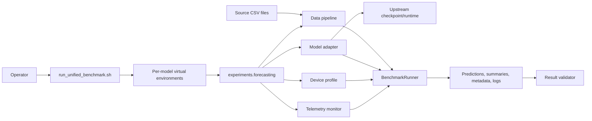
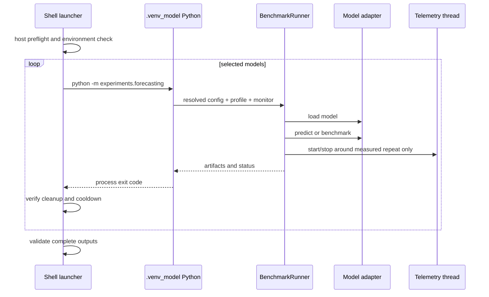

# Architecture

This document describes the first-party PowerBench architecture. Vendored model
implementations under `utils/` are upstream dependencies and are intentionally
isolated from benchmark policy.

## System Context



The shell launcher owns cross-process orchestration and host preparation. The Python
entry point owns one model's benchmark lifecycle. `BenchmarkRunner` is the central
policy engine; model adapters, device profiles, and monitors expose narrow interfaces
to it.

## Component Map

| Component | Responsibility | Important boundary |
|---|---|---|
| `powerbench/` | Expose the installable package API and console entry point. | Defers PyTorch and model imports until command execution. |
| `run_unified_benchmark.sh` | Resolve configuration, prepare host, create/check model environments, invoke phases, cool, resume, and validate. | Never imports model packages into the launcher process. |
| `experiments/forecasting.py` | Parse one model invocation, configure logging, detect/select device profile and monitor, build `BenchmarkConfig`, invoke the runner. | One model and one isolated Python environment per process. |
| `benchmark/config.py` | Pydantic configuration, device categories, result status, and result-row validation. | Rejects invalid configuration before execution. |
| `benchmark/data.py` | Source discovery, CSV validation, median imputation, source cache, window indexing, and prepared benchmark pools. | Does not call a model or monitor. |
| `benchmark/runner.py` | Phase execution, seeding, model lifecycle, warmup, timing, telemetry alignment, statistics, persistence, and failure policy. | The only component that defines the measured interval. |
| `models/base.py` | Common adapter contract. | Adapters accept batched context and return normalized point forecasts. |
| `models/factory.py` | Adapter selection, including CPU-specific implementations. | Device-dependent dispatch is explicit and recorded. |
| `models/*.py` | Upstream model loading and forecast semantics. | No CSV loading, summary persistence, or cross-model state. |
| `benchmark/devices/*.py` | Apply, verify, log, and restore host execution profiles. | Hardware settings are changed outside measurement. |
| `benchmark/monitors/*.py` | Sample physical sensors and summarize an interval. | Sampling threads collect only; metric policy remains in runner/stats. |
| `scripts/*.sh` | Reproducible per-model environment construction. | Each model may pin incompatible package versions safely. |
| `scripts/*_resume.py` | Inspect artifacts and plan model-boundary continuation. | Never treats partial model output as complete. |
| `scripts/validate_results.py` | Enforce output completeness and contamination rules. | Success is reported only after validation. |

## Process Topology



This isolation is deliberate. It prevents one model's CUDA allocator, monkey patch,
thread pool, dependency version, or native extension from affecting the next model.
A process exit is the strongest CUDA cleanup boundary available without resetting
the physical device.

## Data And Control Planes

PowerBench keeps two conceptual planes separate:

- The **data plane** is source arrays, window metadata, prepared batches, model
  tensors, forecasts, and monitor samples.
- The **control plane** is phase selection, device settings, cooldown, seeding,
  memory guards, timeout/OOM policy, resume planning, and validation.

The runner is where they meet. A device profile can configure hardware but cannot
alter windows; a model adapter can transform its input as required by the released
model but cannot alter the benchmark schedule; a monitor can sample sensors but
cannot extend the timed interval.

## Core Data Structures

### `SourceSeries`

A validated independent time series containing contiguous `float32` values, a
boolean observed mask, compact `int64` timestamps, gap-segment boundaries, source
identity, and preprocessing audit metadata.

### `MultiSourceWindowDataset`

Maps one global deterministic index to one complete source-local window. NumPy
`sliding_window_view` provides vectorized window views. The index cannot bridge a
source boundary or timestamp gap. The forecast stride defaults to the horizon.

### `PreparedBenchmarkStream`

Materializes a bounded contiguous pool before telemetry starts. The pool contains at
least one full requested batch and at most the configured preload bound unless the
requested batch itself is larger. A repeated tail makes wraparound batches
contiguous, so `batch(i)` is a zero-copy slice. It cycles deterministically until
exactly the configured number of full batches has been emitted.

### `ResultRow`

A per-repeat record. It contains identifiers, protocol counts, timing,
throughput, power/energy, memory/utilization/thermal metrics, device scope, seed,
and validity status. Summary rows are derived only after all repeats for a
configuration finish.

## Dependency Direction

```text
run_unified_benchmark.sh
    -> experiments.forecasting
        -> benchmark.config
        -> benchmark.runner
            -> benchmark.data
            -> models.factory -> models.base / models.<adapter>
            -> benchmark.devices.<profile>
            -> benchmark.monitors.<backend> -> benchmark.monitors.stats
```

Lower-level components do not import the launcher. Model adapters do not import the
runner. Monitors do not know model names. These constraints keep experimental policy
reviewable and make adapter/device additions local.

## Extension Points

### Add a model

1. Implement the common adapter contract in `models/<name>.py`.
2. Register it in `models/factory.py` and define CPU dispatch if required.
3. Add `scripts/<name>.sh` with pinned dependencies and a preflight import.
4. Add it to launcher model order only after prediction-equivalence and stress tests.
5. Record checkpoint, forecast statistic, preprocessing, sampling, compilation, and
   backend semantics in `docs/MODELS_AND_DEVICES.md`.
6. Add adapter tests for input transport, output shape, deterministic behavior, and
   every local intervention.

### Add a device

1. Add a `DeviceCategory` and robust detection signal.
2. Implement `DeviceProfile` setup/apply/verify/teardown without entering timing.
3. Implement a monitor whose `power_scope` names the actual physical boundary.
4. Add throttle/contamination checks and unsupported-sensor behavior.
5. Add device tests and a device-local environment template.

### Add a dataset

Prefer configuration over code changes. Place independent CSVs under one dataset
folder and set `DATASET_FOLDER`, `POLLUTANT`, and optionally `SOURCE_PATTERN`,
`TIME_COLUMN`, and `TARGET_COLUMN`. A new preprocessing rule is a methodological
change and requires tests, metadata, documentation, and regenerated predictions.

## Architectural Invariants

The following are publication-critical and should be treated as API contracts:

- Phase 1 has no performance telemetry or accuracy calculation.
- Phase 2 has no forecast persistence or accuracy calculation.
- Data preparation finishes before measured inference.
- Every measured iteration contains the same number and order of full batches.
- Progress rendering and disk output do not occur inside measured repeats.
- All samples used for power statistics are aligned to the actual repeat interval.
- A model process failure cannot be hidden by later model success.
- Partial outputs are never accepted as resumable completion.
- Adapter interventions that change timed overhead invalidate old performance rows,
  even when prediction equivalence is proven.
