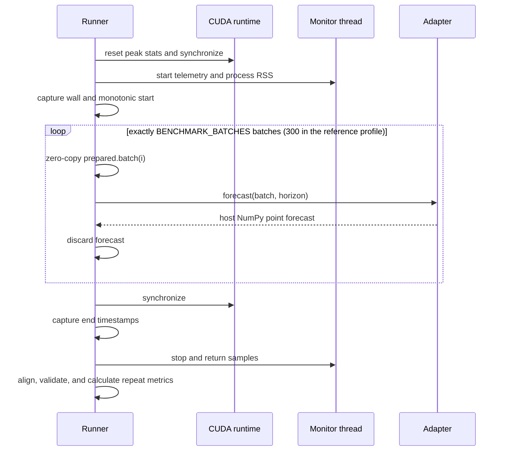

# Workflow

PowerBench uses one deterministic dataset pipeline followed by two operationally
separate phases. This document follows a run from shell invocation to validated
artifacts and identifies the library used at each stage.

## Stage And Library Register

| Stage | Primary implementation/library | Role |
|---|---|---|
| Orchestration | Bash, GNU/Linux tools | Host setup, process isolation, environment selection, cooldown, resume, exit handling. |
| Configuration | Shell environment, `argparse`, Pydantic | Resolve host controls, parse CLI values, validate typed benchmark configuration. |
| Tabular input | pandas | CSV parsing, timestamp conversion/sorting, duplicate median collapse. |
| Numerical data | NumPy | Compact typed arrays, non-finite handling, window views, contiguous benchmark pools, prediction memory maps. |
| Dataset iteration | PyTorch `Dataset`/`DataLoader` | Deterministic Phase 1 batches; `shuffle=False`, seeded workers. |
| Model execution | PyTorch and each upstream model API | Tensor conversion, device execution, model-specific point forecast extraction. |
| GPU control/telemetry | `nvidia-smi`, NVML (`nvidia-ml-py`), PyTorch CUDA | Clocks/persistence, board power, utilization, temperature, physical VRAM, allocator memory, synchronization. |
| Jetson control/telemetry | `nvpmodel`, `jetson_clocks`, sysfs, `tegrastats` | MAXN/clock/fan control, rail power, shared memory, temperatures, utilization, OC detection. |
| CPU telemetry | Intel RAPL sysfs, thermal sysfs, psutil | Package energy/power, temperatures, process-tree RSS. |
| Timing | `time.perf_counter`, `time.time_ns` | Monotonic duration and wall-clock alignment with telemetry. |
| Statistics | NumPy, pandas, Student-t constants | Repeat metrics, mean, sample standard deviation, 95% confidence interval. |
| Persistence | NumPy NPZ, pandas CSV, JSON | Predictions, summary tables, preprocessing/provenance metadata. |
| Progress/logging | Python logging, `tqdm` | Detailed per-model file logs and lightweight terminal status outside timing. |

## 1. Launch And Host Preparation

`run_unified_benchmark.sh` is the only production launcher. It:

1. reads command-line phase selection;
2. loads `.benchmark-device.env` when present;
3. resolves dataset, models, protocol counts, timeouts, memory guards, cooldowns,
   threads, output directory, and seed;
4. creates a new run directory when existing output would otherwise mix independent
   studies;
5. raises the open-file limit where permitted;
6. prepares sudo keepalive and read permissions for RAPL/governor controls;
7. rejects active swap contamination according to policy;
8. configures CPU thread variables or Jetson SSD-backed caches;
9. checks/creates one virtual environment per selected model;
10. records source checksums and a Python/package snapshot for each model process.

On Jetson, Hugging Face, Torch, uv, pip, XDG, and temporary caches prefer a writable
NVMe/SSD. If no SSD exists, the repository/eMMC path remains valid. This selection
changes storage placement, not model arithmetic.

## 2. Source Discovery And Preprocessing

`discover_source_files` recursively resolves the configured glob and returns a
stable sorted list. Each CSV is loaded independently by `load_source_file`:

1. The time and target columns are selected explicitly or inferred.
2. pandas parses timestamps as UTC; invalid timestamps are dropped.
3. Rows are stable-sorted so duplicate ordering is deterministic.
4. Duplicate timestamps collapse to their median target.
5. Infinite values become missing.
6. One finite global median for the source imputes model-input gaps. A boolean mask
   preserves which forecast targets were originally observed.
7. The median sampling interval is inferred and larger discontinuities produce
   segment boundaries.
8. Values are stored as contiguous NumPy `float32`, masks as `bool`, and timestamps
   as compact `int64` values.

The cache is an atomic NPZ keyed by cache schema, relative path, file size, file
modification time, and selected columns. A changed source or schema therefore misses
the cache. Cache reads and writes occur outside inference measurement.

## 3. Window Construction

For context `C`, horizon `H`, and stride `S` (normally `H`), a valid window needs
`C+H` points inside one contiguous source segment. The dataset computes every valid
start index and discards the final incomplete remainder. It never concatenates CSVs
before windowing.

One sample contains:

```text
context:              float32[C]
target:               float32[H]
target_observed:      bool[H]
source/window IDs:    scalar metadata
context indices:      int64[C]
forecast indices:     int64[H]
forecast timestamps:  int64[H]
```

`sliding_window_view` creates window views without constructing one Python list per
window. Phase 1 uses a deterministic DataLoader. Phase 2 bypasses per-item loading
through a prepared contiguous stream.

## 4. Phase 1: Prediction Generation

The objective of Phase 1 is only to produce one stable forecast artifact for later
accuracy evaluation.

### Lifecycle

1. The launcher starts a fresh interpreter in the model's own virtual environment.
2. The runner seeds Python, NumPy, PyTorch, CUDA, and DataLoader workers.
3. All selected sources are loaded and the preprocessing audit/manifest is written.
4. The model is constructed once with the fixed prediction batch size, default 512.
5. A `shuffle=False` DataLoader traverses every complete window once in stable order.
6. Predictions are normalized to exact shape `(batch, horizon)` and checked finite.
7. Forecasts and metadata are written into temporary NumPy memory maps rather than
   accumulated as Python objects.
8. One independent NPZ is saved per model/source/context/horizon.
9. The process exits, releasing its model, native libraries, workers, and CUDA state.

No power monitor, process-memory sampler, performance timer, or accuracy metric is
started. Compression/persistence therefore cannot alter performance rows.

### Prediction identity

The prediction artifact records `seed=12345` and `prediction_batch_size=512` by
default. Batch size is not swept in this phase. Performance rows contain no accuracy
columns, which prevents a benchmark batch size from being mistaken for a forecasting
method variable.

### Phase boundary

After all models complete, the launcher checks NVIDIA compute processes against the
pre-phase baseline. A newly leaked process is an error. The system then cools for 20
minutes before Phase 2.

## 5. Phase 2: Benchmark Preparation

For every model, power mode, context, horizon, and requested batch size:

1. The model is reseeded and constructed fresh.
2. A CPU/GPU memory guard projects whether the batch can execute safely.
3. `PreparedBenchmarkStream` selects a deterministic pool of windows. The default
   bound is 65,536 windows, but at least one full requested batch is retained.
4. If fewer unique windows are available than required, the pool cycles
   deterministically. Under the reference profile, the benchmark executes the
   configured 300 full batches.
5. A repeated tail is appended once, before telemetry, so wraparound batches remain
   contiguous zero-copy views.
6. The model stabilizes for 30 seconds.
7. A fresh idle baseline is collected while both model and prepared pool are
   resident. This baseline belongs to the configuration, not to an empty process.

The profile applies the requested device state before this lifecycle, waits 100
seconds, and verifies that state again.

## 6. Warmup

Two complete warmup iterations run the same 300-batch sequence that measurement will
use. Warmup predictions are immediately discarded, and no warmup telemetry enters
the result. Warmup absorbs lazy module initialization, CUDA context creation, kernel
selection/autotuning, allocator growth, compilation that remains on first call, and
cache population.

Warmup progress may redraw every two seconds because it is outside measurement.

## 7. Measured Repeat

The measured lifecycle is deliberately narrow:



There is no terminal redraw or file write while this sequence runs. GPU
synchronization ensures asynchronous kernels finish before the end timestamp.
`time.perf_counter` supplies elapsed time; `time.time_ns` defines the wall-clock
interval used to align sensor samples.

The adapter call includes required model-specific tensor conversion, host-to-device
transfer, forward/generation, point-statistic extraction, device-to-host transfer,
and output normalization. It is not a pure CUDA-kernel measurement.

## 8. Repeat Finalization And Summary

At repeat end, PowerBench:

1. retains in-window telemetry and interpolates only power at interval boundaries;
2. integrates timestamped power using the trapezoidal rule;
3. calculates throughput, latency, power, energy, memory, utilization, thermal, and
   pipeline-overhead metrics;
4. checks swap growth and device-specific throttle/OC evidence;
5. assigns a validity status;
6. retains the repeat row in memory unless optional raw-repeat persistence is on.

After all repeats, successful rows are aggregated into one configuration summary.
GPU and Jetson use five repeats by default; CPU uses two because of execution cost.
Every numeric field receives mean, sample standard deviation (`ddof=1`), and a
two-sided 95% Student-t confidence-interval half-width when defined.

Only then is the summary appended to disk. The model and pool are destroyed, CUDA
cache is cleared, and the launcher cools for five minutes before another batch size
or model.

## 9. Failure And Continuation Semantics

- A handled CUDA/host OOM records a terminal ceiling and skips larger batch sizes for
  only that model/context/horizon.
- The adaptive GPU memory guard can record the same ceiling before launch when a
  projected batch would exceed the safe physical-memory budget.
- CPU configurations and prediction model processes have a default five-hour
  timeout. A timeout does not erase completed earlier models.
- Swap growth creates `SWAP_CONTAMINATED`; Jetson/Raspberry Pi throttle evidence
  creates `HARDWARE_THROTTLED`. These are invalid, not successful measurements.
- A native process failure stops the current phase at that model. A rerun resumes at
  its model boundary rather than accepting partial rows.

## 10. Validation

The prediction validator checks artifact count, keys, shapes, finite forecasts,
source metadata, seed, and fixed prediction batch. The benchmark validator checks
expected repeat coverage, statuses, finite required metrics, telemetry availability,
prediction independence, and absence of accuracy columns. Only a validated phase is
reported as complete.

## TTM Trace Across Devices

The data and TTM forecast definition stay fixed; only profile, monitor, and numerical
backend differ.

| Stage | H100 / H200 / RTX 5090 / A6000 | Jetson AGX Orin | x86 CPU |
|---|---|---|---|
| Adapter | TTM r3, first-value pad 512 to 1024, native 96 point output | Same adapter semantics | Same adapter semantics |
| Execution | CUDA eager PyTorch | CUDA on integrated GPU/shared memory | CPU eager PyTorch |
| Profile | NVML persistence/max supported clocks/power verification | MAXN mode 0, `jetson_clocks`, max fan, OC verification | Performance governor where permitted |
| Power | NVML GPU board power | Sum of named GPU_SOC, CPU_CV, and SYS_5V rails | Intel RAPL CPU package |
| Memory | PyTorch allocation/reservation + physical dedicated VRAM + process RSS | PyTorch allocation/reservation + shared unified memory + process RSS | Process and recursive-child RSS |
| Thermal/utilization | NVML GPU temperature/compute | `tegrastats` GPU/CPU temperature and GR3D | CPU thermal sysfs; no GPU fields |

These physical scopes differ. Cross-device throughput is directly interpretable
under the same workload, but power and energy must retain their scope labels and
must not be described as equivalent wall-system measurements.
